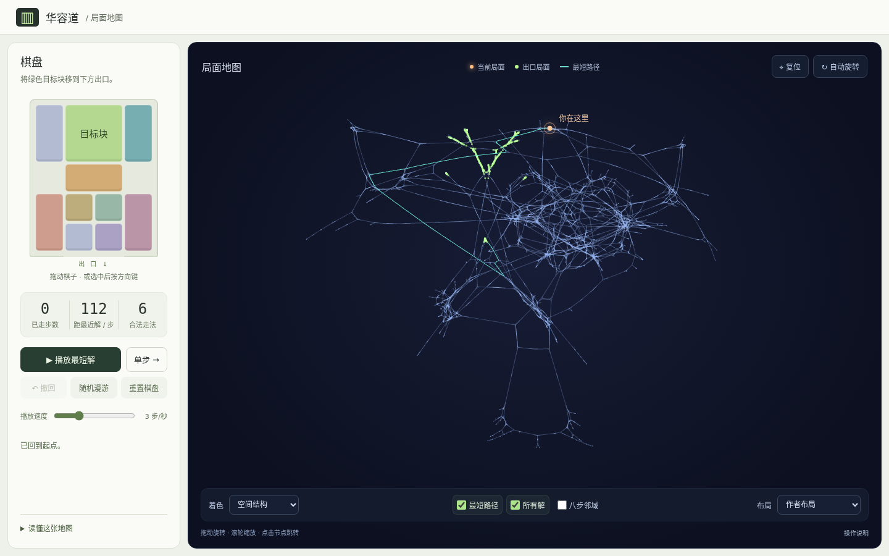
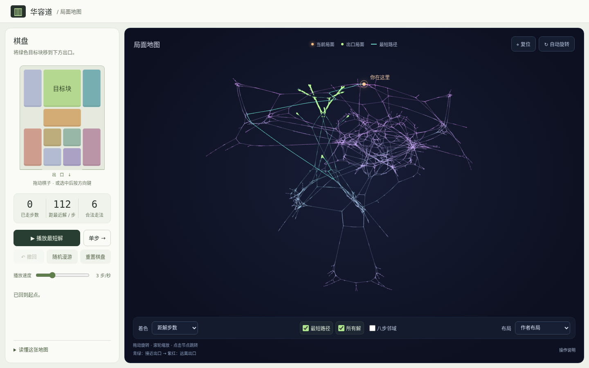

# 华容道 · 局面地图

**移动一块棋子，走过图中的一条边。** 一个连接华容道棋盘、最短路径和三维状态图的交互式学习项目。

基于 2swap《I Solved Klotski》及其公开数据，重新实现浏览器交互与规则验证，并参考历史源码实现 CUDA 离线布局计算。这里展示的是同一棋子配置下的**一个连通分量**：25,955 个局面、41,948 条无向边、964 个出口局面。



[快速运行](#快速运行) · [从这里开始学习](#从这里开始学习) · [来源与贡献](#来源与贡献) · [架构与数据格式](docs/architecture.md) · [参与贡献](CONTRIBUTING.md)

## 可以体验什么

- **棋盘与地图联动**：拖动棋子或用方向键移动，地图标出当前局面；点击图中的节点可跳转。
- **最短解**：单步、播放、暂停、调速和撤回；每一步说明移动的棋子与距最近解的变化。
- **自由探索**：随机漫游、八步局部邻域、解集高亮，以及按距解步数或棋子相对位置染色。
- **布局对照**：切换作者公开坐标与本地 CUDA 重算坐标，观察同一张图的不同空间布局。
- **手机浏览**：切换「棋盘与求解」「局面地图」，保留当前局面和求解进度。



[查看手机棋盘](docs/images/mobile-board.png) · [查看手机地图](docs/images/mobile-map.png)

建议第一次这样体验：先按「单步」，观察棋盘与橙色标记一起移动；再选择「距解步数」；最后打开「八步邻域」，看看八步之内能到达哪里。

## 快速运行

只需 **Python 3 和支持 WebGL 的浏览器**。体验页面不需要安装 npm 包、不需要构建，也不需要 NVIDIA GPU。应用资产全部随仓库提供，不依赖 CDN。

```sh
# 在仓库根目录运行
python3 -m http.server 5173 --bind 127.0.0.1 --directory public
```

打开 [本地演示](http://127.0.0.1:5173/)。已安装 Node.js 时也可执行 `npm start`。

直接体验 [重新生成的布局](http://127.0.0.1:5173/?layout=rebuilt)。请通过 HTTP 服务打开页面，直接双击 HTML 文件会受到浏览器本地文件访问限制。

| 操作 | 方法 |
|---|---|
| 移动棋子 | 拖动一块棋子，或选中后按方向键；每次移动一格 |
| 观察地图 | 拖动旋转、滚轮缩放、Shift + 拖动平移 |
| 地图键盘操作 | 聚焦地图后，方向键旋转，`+` / `-` 缩放，`0` 复位 |
| 从另一局面开始 | 点击地图节点；清空当前走步记录，从所选局面继续 |
| 查看局部结构 | 勾选「八步邻域」，突出显示当前局面八步内的节点 |

静态部署时，将 `public/` 作为站点根目录即可，无须后端。离线计算脚本和研究材料无需部署。

## 从这里开始学习

这个项目的重点，是把几个知识点连接为可以运行、观察和验证的系统。

| 知识点 | 在这里如何体现 | 建议阅读 |
|---|---|---|
| 建模 | 棋盘格的位置与状态图节点的位置是两回事；合法移动成为边 | [`engine.js`](public/engine.js) 的 `pieces`、`move` |
| 等价关系 | 按首次出现顺序重新命名棋子，消除 ID 差异，保留占格关系 | `canonical` |
| 图算法 | 多源 BFS 求最近解距离；BFS 遍历安排布局增长；八步 BFS 探索局部 | `createModel`、`build_topology`、`GraphView.update` |
| 数值计算 | 非线性边力、排斥、速度、阻尼、镜像约束与四维松弛 | [布局研究记录](research/layout.md) |
| 算法加速 | 近桶逐点计算，远桶以质心和节点数近似排斥 | [`layout_kernel.cu`](scripts/layout_kernel.cu) |
| 并行计算 | CUDA 并行计算受力，双缓冲避免更新时读到混合状态 | CUDA 内核与 [`generate_layout.py`](scripts/generate_layout.py) |
| 图形学 | 三维坐标正交投影、WebGL 批量绘制、屏幕坐标拾取 | [`graph.js`](public/graph.js) |
| 系统设计 | 昂贵的布局离线计算；浏览器加载坐标并处理轻量交互 | [架构与数据格式](docs/architecture.md) |

阅读顺序建议是 **规则 → 规范化 → BFS → 交互 → 渲染 → CUDA**。不需要先学会 GPU 编程才能理解棋盘与求解。

## 来源与贡献

本项目不是原作者的官方版本。不同部分的来源与工作范围如下：

| 部分 | 来源与本项目的工作 |
|---|---|
| 视频与系统思路 | 2swap 的 [I Solved Klotski](https://www.youtube.com/watch?v=YGLNyHd2w10) |
| 原始局面、拓扑与作者坐标 | [2swap/Klotski-Webpage](https://github.com/2swap/Klotski-Webpage)；转换时去重邻接项、居中并统一缩放坐标 |
| 规则与求解 | 本项目实现移动规则、等价局面规范化、多源 BFS、路径恢复，并逐节点核验上游邻接关系 |
| 前端 | 本项目实现中文界面、棋盘交互、WebGL 图视图、播放、染色、局部探索及布局切换 |
| 重算布局 | 参考 SwapTube 历史力学公式，移植为 Python 调度 + CUDA 内核，从已有拓扑重新计算坐标 |
| 研究与验证 | 追踪源码版本、参数变化、实现差异，进行 CPU/GPU 对照、消融和参数反推实验 |

固定版本、数据校验值及转换细节见 [来源记录](docs/provenance.md) 与 [数据清单](docs/data-manifest.json)。代码和随附数据按 **GPL-3.0** 提供，详见 [LICENSE](LICENSE)。

## 已实现到哪里

- 一步定义为棋子沿一个方向**平移一格**。作者开局距最近解 112 步，与常见标准开局相差 4 步；请勿与采用不同计步规则的解法直接比较。
- 当前拓扑来自上游，规则独立实现并核验。布局生成器遍历已有图安排增长；尚未提供从单一起点独立枚举完整拓扑的生成器。
- 三维坐标是布局结果。**欧氏距离不是移动步数**，更换布局不会改变可达性和最短解。
- 重算没有使用作者 xyz 初始化或优化，复现的是历史力学模型及主要设计，**不承诺逐点还原作者坐标**。
- 视频版参数已从历史源码确认；旧网页坐标那次生成的完整配置仍未找回，拟合参数不能当作作者原参。
- 尚未复现视频中的全部关卡和剪辑；密集区域的节点拾取、移动端触控还有改进空间。


详细结果见 [布局算法追踪](research/layout.md) 和 [原始参数追查](research/parameter-recovery.md)。上图是离线研究对照；页面提供「作者布局」与原有种子 7 重算布局，最佳候选另存为 `layout-candidate.json`。

## 验证与复现

普通规则、数据和视图更新测试只需 Node.js 22 或更高版本：

```sh
npm test
```

检查覆盖全部节点的合法邻边、规范化唯一性、最短路径合法性、布局数据校验，以及切换布局不修改规则模型、普通走步不重复上传全图缓冲。格式化工具是开发依赖，不参与页面运行：

```sh
npm ci
npm run format:check
```

Python 环境建议使用 3.10–3.12；本机验证版本为 3.12.2：

```sh
python3 -m venv .venv
. .venv/bin/activate
pip install -r requirements-layout.txt
python3 tests/test_topology.py   # 仅 CPU，无须 CUDA
```

重算布局另外需要 NVIDIA GPU 和 CUDA Toolkit（`nvcc`）。下列命令将结果写到研究目录，不覆盖页面当前布局：

```sh
python3 scripts/generate_layout.py --output research/runs/my-layout.json
python3 tests/test_layout.py

# 参数研究和绘图额外依赖
pip install -r requirements-research.txt
python3 tests/test_parameter_inference.py
```

完整研究流程见对应研究记录。普通 GitHub Actions 检查规则、数据、格式和 CPU 拓扑；GPU 测试需在具备 CUDA 的机器上运行。固定种子不保证不同 GPU 上的浮点结果逐位相同。

## 后续方向

- 从棋盘规则独立枚举状态图，并与上游拓扑交叉验证。
- 节点棋盘预览与更准确的密集区域拾取。
- 展示 BFS 扩展、规范化与布局受力的分步教学模式。
- 可分享的当前局面链接，以及更多棋子配置。

欢迎从文档、无障碍、测试和交互体验开始贡献，流程见 [CONTRIBUTING.md](CONTRIBUTING.md)。
