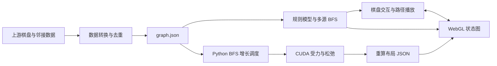

# 架构与源码阅读路线

## 两种位置，两条计算路径

棋盘位置决定游戏规则：例如目标块的左上角在第 1 行第 2 列。状态图位置是布局算法生成的 xyz，只决定一个完整棋盘局面画在哪里。两者不能互相代替。



浏览器不执行 CUDA。重算布局通过文件交付，页面切换时仅替换视图坐标。

## 文件职责

| 文件 | 职责 |
|---|---|
| `public/engine.js` | 棋盘拆解、移动、等价规范化、多源 BFS、路径恢复、一步描述 |
| `public/app.js` | 棋盘状态、撤回历史、播放调度、DOM 事件及视图协调 |
| `public/graph.js` | WebGL 初始化、相机、投影与拾取、局部邻域、绘制缓冲 |
| `public/style.css` | 桌面布局、紧凑高度、手机视图切换及减少动态效果设置 |
| `scripts/prepare-data.mjs` | 上游导出格式转换、邻接去重、坐标归一化 |
| `scripts/generate_layout.py` | BFS 增长顺序、初始化、CUDA 调度、检查点与结果导出 |
| `scripts/layout_kernel.cu` | 分桶、受力、积分和镜像约束 |
| `scripts/infer_layout_parameters.py` | 在给定假设下拟合尺度与力比例，检验终态解释能力 |
| `scripts/search_layout_parameters.py` | 有界候选实验、坐标对齐和指标比较 |

## 传输格式与运行时模型

为减少文件体积，`graph.json` 的节点采用紧凑数组：

```text
{
  source: 上游仓库 URL,
  initial: 长度为 20 的初始棋盘字符串,
  nodes: [
    [board, x, y, z, neighbors, upstreamSolutionDistance, upstreamStartDistance],
    ...
  ]
}
```

- `board` 按行记录 4 × 5 个格子，`.` 是空格；同一字符的格子属于同一棋子。
- `neighbors` 是当前文件中的零基节点索引，一条无向边在两端各记录一次。
- xyz 为居中并统一缩放后的坐标，不是棋盘格坐标。
- 最后两项是上游附带距离。网页求解不使用它们，而是从棋盘出口条件重新计算多源 BFS。
- 节点索引依赖文件顺序，不是跨数据版本稳定的 ID。页面显示的 `STATE` 为索引加一。

`createModel()` 在入口把数组解包为 `nodes: [{ board, neighbors }]`，另存 `positions`。规则算法只读取棋盘和邻接表。`GraphView` 再持有坐标副本，`setPositions()` 不会修改模型中的原始坐标。

重算文件是 `{ metadata, positions }`，其 `sourceGraphSha256` 必须对应当前 `graph.json`。节点数相同并不足以说明两个布局可以互换，顺序也必须一致。当前仓库测试会检查文件校验值与布局来源。

## 求解为何只需一次 BFS

所有满足出口条件的局面同时入队，距离设为零；每沿一条边扩展，距离加一。因为边的代价均为一次单格移动，首次访问就是到最近解的最短距离。

求解时从当前节点选择距离少一的邻居，直到零。多个最短解同时存在时，选择邻接顺序中第一个，未枚举所有最短路径。`boardForNeighbor()` 根据真实移动恢复下一帧棋盘，保留屏幕上的棋子身份与颜色。

## 渲染更新如何控制开销

- 相机变化只更新着色器参数和当前标记，不重新计算规则。
- 全局视图的一次移动只更新最短路径缓冲，不重新上传整张图的边和解集。
- 切换染色更新边颜色；切换布局更新所有几何。
- 开启局部视图后，当前节点变化才重新计算八步邻域并更新高亮。
- CPU 投影与顶点着色器使用相同的正交变换，保证节点拾取和标记对齐。

仍有改进空间：节点拾取在点击时遍历所有节点；局部视图更新仍会重建边数据；画面支持半透明连线，但没有实现按深度选择节点。当前规模可运行，这些改进应先测量再实施。

## 验证入口

| 检查 | 目的 |
|---|---|
| `npm test` | 全图规则、最短解、数据校验、布局隔离与缓冲更新回归 |
| `python3 tests/test_topology.py` | CPU 验证布局遍历不依赖输入坐标、镜像索引互逆 |
| `python3 tests/test_layout.py` | CUDA 与独立 NumPy 参考的一步受力和积分对照 |
| `python3 tests/test_parameter_inference.py` | 历史公式与坐标对齐验证 |

测试不是布局优美程度的证明。布局指标、实验假设与结论限制保留在 `research/` 中。
