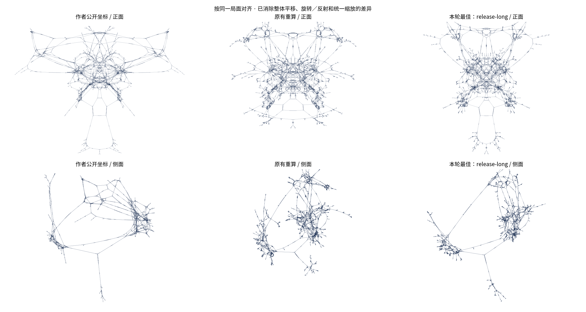

# 原始 3D 布局参数追查（2026-10-12）

## 当前结论

**已找回视频版源码里的参数变化；没有找回旧网页数据那次生成的完整参数、种子和运行轨迹。** 下面的重算是有明确边界的实验，不能称为逐点复现，也不能把反推器输出的最佳拟合值当成作者原参。

本次对照目标是 `public/graph.json` 所保留的作者网页坐标。视频版参数只作为候选来源。现有受力核心本来就是 CUDA C++，Python 负责初始化、调度和导出；差异涉及源码版本、力公式、随机数、遍历顺序、增长过程和更新方式，并非简单的 Python 与 C++ 之别。

## 找到了哪些原始证据

1. [网页数据首次加入的提交](https://github.com/2swap/Klotski-Webpage/commit/069d99b393eb06c37402598393806d84a41813ae) 日期为 **2025-06-21**；[作者 README](https://github.com/2swap/Klotski-Webpage/blob/6e27747b2c5b21553ab9c64855d8eb23bee76ca2/README.md) 明确把生成器称为 `Old-Graph-Spreader`。
2. [正式视频提交](https://github.com/2swap/swaptube/commit/2c7d90dda292ea12245ed90115eb20002fbc3c26) 日期为 **2025-08-22**，晚于网页数据。这不能证明两者完全不同，但也不允许直接把视频参数认作网页参数。
3. 旧仓库地址本次仍为 404。GitHub 仓库搜索（包含 forks）没有找到可确认的副本；Wayback CDX 查询返回空列表。这些查询不证明备份绝不存在。
4. 在 SwapTube 历史中找到了 **2024-07-03 的纯 C++ 版本**：[Graph.cpp，固定提交 `1384210`](https://github.com/2swap/swaptube/blob/13842105e1c2a97b0e168d55601e4f5807cde0e2/src/scenes/Graph.cpp)。它是作者的历史实现，但尚无证据证明它就是生成网页数据的准确版本。

机器可读的源码参数和出处保存在 [recovered-parameters.json](recovered-parameters.json)。

### 视频版：能够从源码确认的数值

来源：[Klotski.cpp](https://github.com/2swap/swaptube/blob/2c7d90dda292ea12245ed90115eb20002fbc3c26/src/Projects/Klotski.cpp#L1306)、[GraphScene.cpp](https://github.com/2swap/swaptube/blob/2c7d90dda292ea12245ed90115eb20002fbc3c26/src/Scenes/Math/GraphScene.cpp#L34)。

| 阶段 | 每帧物理迭代 | decay | dimensions | mirror_force |
|---|---:|---:|---:|---:|
| 起始图增长，前两段各加 100 节点 | 5 | 0.92 | 2.98 | 0 |
| 第三段加 100 节点并过渡 | 5 → 800 | 0.92 → 0.65 | 2.98 → 3.98 | 0 → 0.003 |
| 继续增长到完整图 | 800 | 0.65 | 3.98 | 0.003 |
| 完整图松弛，7.5 秒 | 800 → 400 | 0.65 | 3.98 → 3.95 | 0.003 |
| 冻结，7.5 秒 | 400 → 0 | 0.65 | 3.95 → 3 | 0.003 |

其他参数：`repel=1`、`attract=1`、限速 `20`、居中强度 `0.1`；达到 5,000 节点后使用 `10³` 空间桶。后半段每批加入 `int(ii²/7)` 个节点，`ii` 从 3 开始，每批增加 0.2，请求时长为 `0.033333` 秒。

过渡不是线性的，而是 `smoother2(t)`：前半段 `2t²`，后半段 `1−2(1−t)²`。[插值源码](https://github.com/2swap/swaptube/blob/2c7d90dda292ea12245ed90115eb20002fbc3c26/src/misc/inlines.h#L20)

`go.sh` 指定 30 FPS。不过实际帧数使用**累计音频时间减累计视频时间**再换算，不能逐段简单计算 `int(0.033333×30)`。原音频片段、前序时间累计和浮点舍入都会影响准确调度。[Macroblock.cpp](https://github.com/2swap/swaptube/blob/2c7d90dda292ea12245ed90115eb20002fbc3c26/src/io/Macroblock.cpp#L23)、[Scene.cpp](https://github.com/2swap/swaptube/blob/2c7d90dda292ea12245ed90115eb20002fbc3c26/src/Scenes/Scene.cpp#L89)

### 早期纯 C++：找到了另一套公式

该类的默认值为 `decay=.9`、`speedlimit=3`、`repel_force=1`、`attract_force=1`、`dimensions=2`、`sqrty=true`、重力为 0。这些是**类默认值**，不是已经确认的网页生成配置。初始位置和速度用 `rand()/RAND_MAX` 生成 double 值，范围 `[0,1]`。

设 `Δ=p_i−p_j`、`r²=Δ·Δ`，忽略整体系数：

| 模式 | 排斥贡献 | 沿边吸引贡献 |
|---|---|---|
| `sqrty=true` | `0.5 Δ/(r²+0.1)` | `−0.5 Δ r²/(r²+1)` |
| `sqrty=false` | `0.0025 Δ/(r²+0.1)²` | `−Δ[1/(r²+1)+r²−1]` |

两者均不同于视频版的力公式。源代码位置为上述历史 `Graph.cpp` 的 84–93、463–567 行。

## 反推实验：先验证能不能从终态估计力参数

`scripts/infer_layout_parameters.py` 读取固定提交的未归一化网页坐标。假设它是 **w=0、无重力或硬投影的三维静态平衡**，对三套力公式分别拟合坐标尺度及 `repel/attract`。随机抽 2,048 个节点，1,024 个用于拟合，另 1,024 个只用于验证；每个抽样节点的排斥场都对全部 25,955 个节点精确求和，无分桶近似。

在原始坐标尺度的 `10⁻⁵` 至 `10¹` 倍内，先取 25 个对数网格点，再在最佳网格邻域局部搜索。这是有限范围检验，不能排除范围外或其他模型。

残差定义：`||ratio × F_rep + F_attr|| / ||F_attr||`。0 表示完美抵消，约 1 表示排斥项没有有效解释吸引项；它不是形状相似度或“复现百分比”。

- **已知参数的正对照**：使用本次 `release-seed1` 重算的原始尺度终态，实际比例为 1，反推比例为 **0.99264**，验证残差 **0.06932**。说明这套检验能识别自身模型中接近力平衡的情况；仍存在分桶近似、镜像项和未完全收敛的影响。
- **作者网页坐标**：三种公式、去重与保留重复邻接共六种假设，验证残差约为 **0.9973–1.0000**。部分最优点落在尺度搜索边界，拟合参数没有充分解释力，不能采信为原始参数。
- 原始数据每个节点都把邻接列表第一项重复一次，共 **25,955** 个额外条目。这种规律与导出问题相容，但缺少原导出器，不能断言。保留重复项拟合也没有解决问题。

这些结果不支持“拿最终 xyz 做静态平衡反推就能找到原参”的方法。它们**不能排除**未收敛快照、隐藏第四维、其他力公式、额外约束、手工操作或导出后的坐标变换。尤其无法由单帧位置确定阻尼、初始种子和迭代次数。

完整数值及尺度扫描见 [parameter-inference.json](parameter-inference.json)。

## 从拓扑重新生成的对照

所有候选均从棋盘和连线生成，未使用作者 xyz 初始化或优化。作者坐标只用于最终评价。固定节点身份后，允许最佳平移、旋转／反射和统一缩放，以免把观察视角当成布局差异。

评价指标为：

- `procrustesNrmse`：对齐后坐标误差除以作者坐标相对质心的 RMS 半径，越小越好，完全相同为 0。
- `edgeLengthCorrelation`：41,948 条对应边长度的 Pearson 相关。
- `pairDistanceCorrelation`：固定种子抽取 100,000 对节点，比较对应欧氏距离的 Pearson 相关。

六组实验比较随机种子、纯三维、五倍松弛时长、较高速度保留系数（decay=.92）和两种早期 C++ 力公式。早期 C++ 候选只移植了力公式，仍使用本项目的 BFS、NumPy 初始化、分桶加速和 `.003` 镜像约束，并将维数设为 3。原 C++ 使用 double，此处重算为 GPU float32；**不是原 C++ 整个程序的重播**。

| 候选 | 对齐误差 ↓ | 边长相关 ↑ | 节点对距离相关 ↑ |
|---|---:|---:|---:|
| 原有重算，种子 7 | 0.6310 | 0.8628 | 0.7772 |
| 视频公式，种子 1 | 0.8933 | 0.8566 | 0.6655 |
| 视频公式，全程 3D | 0.7766 | 0.8360 | 0.6787 |
| 视频公式，60,000 + 5,000 次松弛 | 0.4695 | 0.8962 | 0.8696 |
| 视频公式，decay=0.92 | 0.6106 | 0.9062 | 0.8395 |
| 早期 C++ sqrty 公式移植 | 0.5513 | 0.8821 | 0.7980 |
| 早期 C++ 非 sqrty 公式移植 | 0.9333 | 0.0110 | 0.3616 |

本次最佳是延长松弛的 `release-long`：对齐误差由 **0.6310 降为 0.4695**，相对降低约 **25.6%**，但仍有明显整体形状差异。这是本次候选集中的最好结果，不是全局最优，也不是“恢复了 53%”之类的复现比例。

其配置为 `seed=7, repel=1, attract=1, decay=.65, mirror_force=.003`；增长批次每批 80 次，维数 3.98；完整图以维数 3.95 松弛 60,000 次；最后三维松弛 5,000 次。单次计算约 **244.5 秒**（本机 RTX 3090）。

[完整实验数值与元数据](parameter-search.json) · [候选坐标](../public/layout-candidate.json)



```sh
python3 scripts/generate_layout.py --seed 7 --settle-steps 60000 \
  --flat-steps 5000 --output research/runs/release-long-retry.json
```

## 重跑与验证

依赖 Python、NumPy、SciPy、Matplotlib、NVIDIA GPU 和 `nvcc`。这轮搜索是有界的候选实验，不是穷举，也不保证找到全局最优参数。浮点和 GPU 原子求和顺序仍可能导致重跑差异。

```sh
python3 scripts/search_layout_parameters.py
python3 scripts/infer_layout_parameters.py \
  --control research/runs/release-seed1/final-3d.npz
python3 tests/test_topology.py
python3 tests/test_layout.py
python3 tests/test_parameter_inference.py
npm test
```

搜索的日志、每组完整坐标和检查点保存在 `research/runs/`（Git 忽略）。`--reuse` 可复用已完成的实验文件；更改生成器后应去掉该选项重新计算。最优新候选另存为 `public/layout-candidate.json`，没有替换页面原有布局。

独立 NumPy 参考验证三套精确受力及旧公式的积分更新；坐标对齐测试确认消除整体旋转、反射、缩放和平移，但不能掩盖节点身份错配。原布局 CUDA 测试与全图棋盘规则测试也需通过。

要进一步声称“复现当时那一次”，仍需要旧生成器准确版本、运行配置／日志，以及随机状态、遍历顺序、增长和调参过程。当前公开证据不足以唯一恢复这些量。
